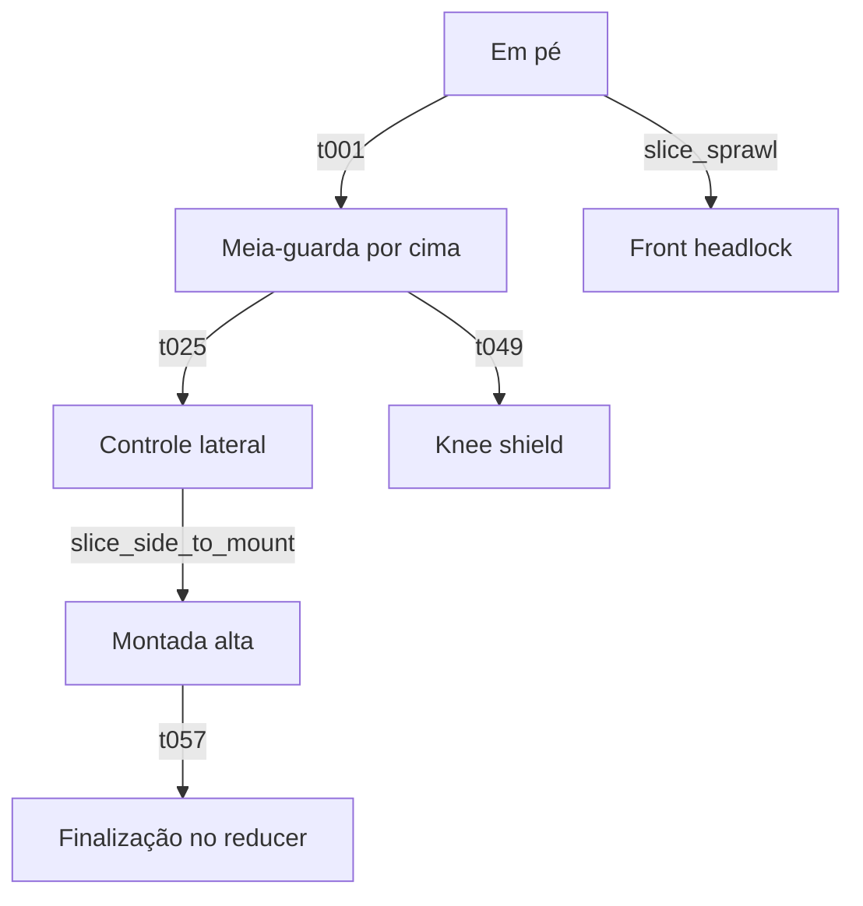

# Animáticos NO-GI — lote de revisão V1

Status: `DRAFT` — material de autoria e revisão.

13 GIFs reais, 78 poses candidatas, 384 × 384 px, seis quadros distintos por GIF, 5,5 segundos por apresentação. O movimento é discreto entre poses; não é animação fluida final. A arte foi gerada por IA e contém problemas visuais registrados individualmente no manifesto. **Zero técnicas estão aprovadas para uso em produção.**

| Família | Prévia |
|---|---|
| Braços | Chave de braço da montada; chave de braço da guarda fechada |
| Ombros | Kimura; americana; omoplata |
| Pernas | Tornozelo reto; kneebar; heel hook interno; toe hold |
| Guardas | De La Riva; Reverse De La Riva; berimbolo |
| Sequência | Queda → meia-guarda → passagem → lateral → montada → chave de braço → soltura |

Todos os itens possuem `visual_triage=REDRAW_REQUIRED`, `biomechanics_review=PENDING`, `shipping=false` e nenhuma autoridade sobre o combate. Exemplos de bloqueios: linha do joelho insuficiente no kneebar, captura do calcanhar ambígua no heel hook, aparente apoio da cabeça na inversão do berimbolo, e passagem incompleta no quadro 3 do fluxo. O texto das poses descreve a **intenção de autoria**, não comprova o que a imagem executa. A inspeção técnica precisa considerar os pixels e corrigir esses problemas.

## Fluxo e autoridade

A referência existente é `data/combat/golden_chain_ruan_davi_v1.json`, vinculada a um **slice não canônico**, não ao grafo completo. O visualizador não instancia CombatManager nem altera estado, dano, gás, score ou vencedor. Os GIFs NO-GI não mudam o perfil GI usado na fixture da golden chain.



As novas entradas DLR, RDLR e berimbolo são rascunhos independentes em `flow.json`; não formam uma cadeia executável. Não foram acrescentadas posições fictícias ao grafo para contornar o bloqueio de fonte. Seatbelt sozinho não concede pontuação de controle das costas. Duração artística de quadro não equivale à estabilização exigida para pontuar.

O alvo integral 40 posições / 120 técnicas / 10 cadeias continua bloqueado em `data/combat/bjj_completion_gate_v1.json`: o grafo integral não está disponível. Este lote não satisfaz esse alvo e não representa “todas as técnicas” do jiu-jitsu.

## ADCC

Pesquisa consultada em 18/10/2026: [regulamento Championship](https://adcombat.com/adcc-rules-regulations/), [portal oficial Opens](https://adcc-official.com/pages/adcc-rules) e [grade Opens 2026, revisada em 20/07](https://cdn.shopify.com/s/files/1/0679/7950/9959/files/2026_Grid_ADCC_Legal_Techs_720_26.pdf?v=1784553461). Championship lista famílias de chaves de braço/ombro/punho e perna/tornozelo, mas não se deve aplicar essa permissão de forma universal a categorias Opens. O pacote identifica a fonte atual; não transcreve nem implementa a matriz por idade/nível. Na ausência de categoria resolvida, a liberação permanece bloqueada. Nenhuma regra existente foi alterada.

## Revisar e reproduzir

- Abrir `production/grappling_gifs_v1/index.html` com a estrutura de diretórios preservada. Galeria offline, busca, filtro, GIFs e pranchas.
- Godot 4.3: `godot --path . res://tools/art/GrapplingGifReview.tscn`. Escolha uma técnica e use Reproduzir, Pausar ou Próxima pose. A reprodução para na recuperação; só Reiniciar retorna ao começo.
- Cada PNG original está em `assets/candidates/grappling/gifs_v1/sheets/`; cada GIF em `gifs/`. `authoring_jobs.json` preserva prompts e nomes originais; `manifest.json` registra SHA-256, recortes, tempos, observações e vínculos bloqueados.
- Gerador de imagens: `image_gen.imagegen`; revisão do modelo não exposta. Personagens ficcionais adultos; variante NO-GI verde/marfim e azul. Direitos e aprovação humana pendentes. A geração não utiliza filmagens ou semelhança de atletas reais.
- FFmpeg apenas extrai os seis quadros e codifica GIF; não desenha anatomia nem fabrica quadros intermediários. A borda de dois pixels é removida para excluir divisórias. Originais preservados, sem edição.

```bash
python -m pip install 'Pillow>=10.2,<13'
python tools/art/build_grappling_gifs.py
python tools/art/render_grappling_review.py
python tools/art/validate_grappling_gifs.py
godot --headless --path . --script res://tests/grappling_gif_review_smoke.gd
```

O primeiro comando de geração exige FFmpeg no PATH e recodifica a mídia; pode mudar hashes entre versões do encoder. A validação apenas lê e mede imagens, não certifica biomecânica, direitos ou identidade. O workflow roda em PRs empilhados, sem filtro pela branch base.

Os dois presets de exportação excluem fontes, GIFs, metadados e visualizador de revisão. Para promoção: corrigir os bloqueios listados, obter evidência física e revisão especializada, revisar regras por categoria, preparar sprites pareados no padrão Sprite Forge e validar contato, escala, pivô e leitura no combate do Godot.
